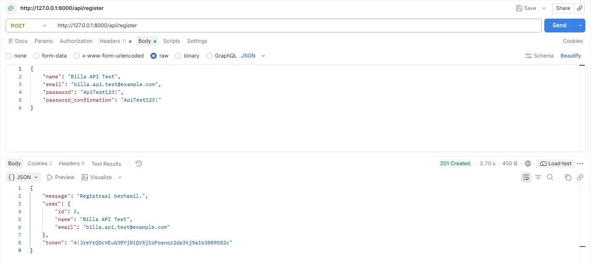
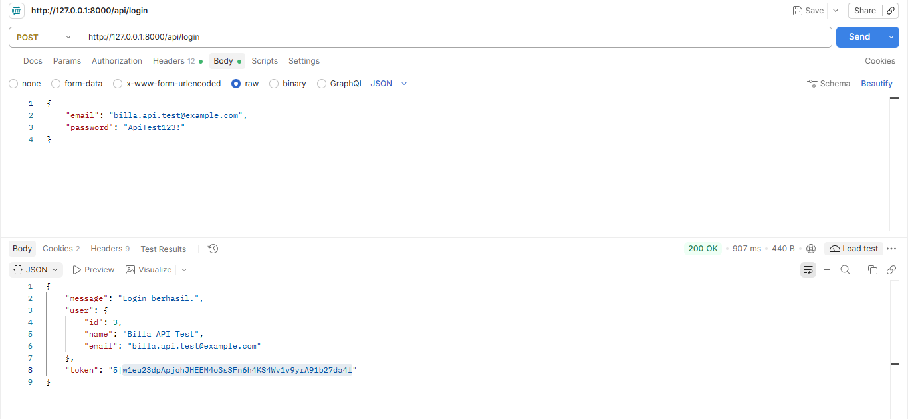

# Laravel REST API — Product Management

RESTful API berbasis Laravel untuk mengelola data produk dan kategori, dilengkapi autentikasi token menggunakan Laravel Sanctum, validasi input, pencarian, filter, pagination, serta upload gambar produk.

## Fitur Utama

- **Autentikasi:** Register, login, logout, dan proteksi API menggunakan Laravel Sanctum.
- **Product Management:** Menampilkan, menambahkan, melihat detail, mengubah, dan menghapus produk.
- **Search:** Pencarian produk berdasarkan kata kunci.
- **Filtering:** Filter produk berdasarkan kategori dan rentang harga.
- **Pagination:** Membatasi jumlah data produk per halaman.
- **Validation:** Validasi input untuk menjaga konsistensi data.
- **Image Upload:** Upload dan pengelolaan gambar produk.

## Teknologi yang Digunakan

- PHP
- Laravel 9
- MySQL
- Laravel Sanctum
- Postman

## Dokumentasi Pengujian API

Seluruh endpoint diuji menggunakan Postman.

### 1. Autentikasi

**Register**


**Login**


**Pengujian Autentikasi API**


**Logout Menggunakan Laravel Sanctum**


### 2. Pengambilan dan Pencarian Data

**Pengambilan Data Produk**


**Data Produk dan Informasi Kategori**


**Detail Produk Berdasarkan ID**


**Pencarian Produk Berdasarkan Kata Kunci**


### 3. Pagination

**Pagination Halaman Pertama**


**Pagination Halaman Kedua**


### 4. CRUD Produk

**Create — Menambahkan Produk Baru**


**Update — Mengubah Data Produk**


**Delete — Menghapus Produk**


### 5. Validasi, Keamanan, dan Upload

**Keamanan API Tanpa Token**


**Token Tidak Valid Setelah Logout**


**Validasi Input Produk**


**Upload Gambar Produk**


## Cara Menjalankan Project

1. Clone repository:

   ```bash
   git clone https://github.com/Nabillasp/latihan-laravel-rest-api.git
   ```

2. Masuk ke direktori project:

   ```bash
   cd latihan-laravel-rest-api
   ```

3. Install dependency:

   ```bash
   composer install
   ```

4. Salin file konfigurasi:

   ```bash
   copy .env.example .env
   ```

5. Generate application key:

   ```bash
   php artisan key:generate
   ```

6. Atur konfigurasi database pada file `.env`, lalu buat database MySQL yang sesuai.

7. Jalankan migration dan seeder:

   ```bash
   php artisan migrate --seed
   ```

8. Buat symbolic link untuk penyimpanan gambar:

   ```bash
   php artisan storage:link
   ```

9. Jalankan server Laravel:

   ```bash
   php artisan serve
   ```

   Server lokal secara default tersedia di `http://127.0.0.1:8000`.

## Catatan

- Gunakan token Bearer pada endpoint yang memerlukan autentikasi.
- Sesuaikan konfigurasi database pada file `.env` dengan lingkungan masing-masing.
- Jangan mengunggah file `.env` atau token autentikasi ke repository publik.

## Repository

[GitHub — latihan-laravel-rest-api](https://github.com/Nabillasp/latihan-laravel-rest-api)
